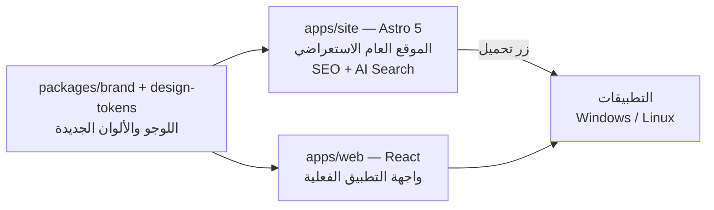

# خطة SITE-01: موقع صافي الاستعراضي، هوية جديدة كاملة

> الحالة: **مسودة تنتظر موافقة المالك**. لن يبدأ التنفيذ قبل الموافقة على القرارات في القسم 8.

---

## 1. الهدف
موقع **استعراضي فقط** يبهر الزائر ويخليه عايز ينزّل التطبيق.
- الزائر **يتفرّج** على البرنامج وهو شغّال (عروض مسجّلة ومتحركة)، لكن **ميقدرش يشتغل** على بيانات.
- الشغل الحقيقي كله في التطبيقات (ويندوز ولينكس، والموبايل بعدين).
- الموقع يكون أسرع وأوضح موقع ممكن لمحركات البحث (Google وBing) ولمحركات الذكاء الاصطناعي (ChatGPT وPerplexity وGemini وClaude).

---

## 2. اكتشاف مهم قبل البدء ⚠️
تطبيق الديسكتوب ([tauri.conf.json](../../apps/desktop/src-tauri/tauri.conf.json)) **بيستخدم `apps/web` كواجهة ليه**:
```
"frontendDist": "../../web/dist"
```
يعني لو حوّلنا `apps/web` لموقع استعراضي، **تطبيق ويندوز هيفقد كل أدواته**.

**الحل المقترح:** نعمل موقع جديد منفصل `apps/site` بـ **Astro 5**، وده نفس اللي المواصفة القسم 12.1 قايلاه بالظبط. ونسيب `apps/web` كواجهة للتطبيق، ونطبّق عليها الهوية الجديدة كمان.



---

## 3. الألوان، بأسلوب Apple وGoogle

Apple وGoogle بيعتمدوا على **الأبيض والأسود بشكل أساسي**، واللون المميّز بيظهر في أماكن قليلة ومدروسة. ألوانك الثلاثة جميلة، لكن عندها مشكلة تباين:

| المزيج | التباين | النتيجة |
|---|---|---|
| `#7A5B7E` على `#E2D8E4` | 4.2:1 | ❌ يفشل في النص العادي (المطلوب 4.5) |
| `#AD97B0` على `#E2D8E4` | 1.9:1 | ❌ يصلح للزخرفة فقط |
| `#7A5B7E` على أبيض | 5.8:1 | ✅ |

**المقترح «Lilac Pro»:** ألوانك الثلاثة تفضل هي هوية البراند، ونضيف لونين محايدين للنص والخلفية:

| الدور | الفاتح | الداكن |
|---|---|---|
| الخلفية | `#FBFAFC` | `#0E0A10` |
| الأسطح | `#FFFFFF` | `#17121A` |
| النص الأساسي | `#1C1420` (أسود بنفسجي) | `#F6F2F7` |
| النص الثانوي | `#5E4A62` (تباين 8:1) | `#BCA9BF` |
| **Main** `#E2D8E4` | خلفيات ناعمة، شارات، تظليل | تدرجات خافتة |
| **Sec** `#AD97B0` | حدود، توهّج، رسوم | لون مميّز (تباين 7.3:1) |
| **Third** `#7A5B7E` | روابط، أزرار، أيقونات | حدود قوية |
| الزر الرئيسي | خلفية `#1C1420` ونص أبيض (زي Apple) | خلفية `#F6F2F7` ونص `#1C1420` |

---

## 4. اللوجو الجديد، 3 اتجاهات للاختيار

| # | الفكرة | الحركة (الموشن) |
|---|---|---|
| **أ** | **«ص» بخط واحد متصل** دايرتها بتتحوّل لقطرة ماء | الخط بيترسم في ضربة واحدة، القطرة بتنزل، وتعمل تموّج |
| **ب** | **المصفاة الهندسية**: 3 خطوط متعرّجة (بيانات ملخبطة) بتعدّي من عدسة وتطلع خط واحد مستقيم | الخطوط بتتفرد وهي معدّية من العدسة، ستايل Google |
| **ج** | **شبكة النقاط**: 9 نقاط متبعترة بتتجمّع وتكوّن حرف «ص» | تطوير لحركة المواصفة 7.2 (2.6 ثانية) |

**هيتسلّم:** SVG رئيسي، ونسخة أحادية اللون، و favicon بمقاسات 16 و32 و180 و512، وأيقونة التطبيق، وصورة مشاركة PNG بمقاس 1200×630.

---

## 5. الأفكار الإبداعية (ترتيب الصفحة)

| # | القسم | الفكرة الإبداعية | الأداة |
|---|---|---|---|
| 0 | **الإنترو** | «من الفوضى للوضوح»: حروف وأرقام عربية ملخبطة (أحمد/احمد، ٠١٢/012) بتتشفط في فلتر سائل وتتحوّل للوجو. مدته 2.6 ثانية، فيه زر «تخطّي»، بيظهر مرة واحدة في الجلسة | GSAP Timeline + SVG |
| 1 | **Hero** | عنوان ضخم بأسلوب Apple، وتحته شاشة التطبيق بتطفو وبتميل مع حركة الماوس | BlurText + Tilt |
| 2 | **العدسة السحرية** ✨ | جدول بيانات ملخبط، وتحت الماوس **عدسة زجاجية** تعرض نفس البيانات وهي نضيفة. دي الفكرة اللي هتبهر الزائر | Lens + clip-path |
| 3 | **التنظيف أثناء التمرير** | جدول مثبّت بيتنضّف خطوة بخطوة كل ما الزائر ينزل، زي صفحات منتجات Apple | ScrollTrigger + Lenis |
| 4 | **ذكاء العربية** | كتابة تلقائية بتعرض: «أ.د. أحمد عبد الله» ← «احمد عبدالله»، والرقم القومي ← تاريخ الميلاد والمحافظة | DecryptedText |
| 5 | **الخصوصية** | لابتوب حواليه درع، وحزم الشبكة بتخبط فيه وترجع، وعدّاد ثابت على «0 بايت أُرسلت» | CountUp + SVG |
| 6 | **الرسوم البيانية** | رسم بياني واحد بيتحوّل من أعمدة لخطي لدائري مع التمرير | GSAP morph |
| 7 | **المميزات** | شبكة Bento ببطاقات عليها إضاءة بتتبع الماوس | SpotlightCard |
| 8 | **المقارنة** | صافي مقابل Excel وPower Query | جدول |
| 9 | **التحميل** | أجهزة (لابتوب وموبايل) وأزرار تحميل مغناطيسية | Magnet + StarBorder |
| 10 | **الأسئلة الشائعة** | أسئلة حقيقية (ومهمة جدًا لمحركات البحث والذكاء الاصطناعي) | Accordion |

**قواعد الحركة:** حركة رئيسية واحدة أو اثنين في كل شاشة. كل حاجة بتقف مع `prefers-reduced-motion`. 120fps باستخدام transform وopacity بس.

---

## 6. الظهور في البحث والذكاء الاصطناعي

| ما سننفّذه | لماذا |
|---|---|
| Astro يولّد HTML ثابت جاهز | المحركات بتقرأ المحتوى فورًا (الموقع الحالي صفحة فاضية لحد ما JavaScript يشتغل) |
| JSON-LD: `SoftwareApplication` و`Organization` و`FAQPage` و`WebSite` | نتائج غنية في Google وفهم أدق من الذكاء الاصطناعي |
| `llms.txt` و`llms-full.txt` | ملخص مخصص لمحركات الذكاء الاصطناعي |
| `robots.txt` يسمح لـ GPTBot وClaudeBot وPerplexityBot وGoogle-Extended | السماح للذكاء الاصطناعي بفهرسة الموقع |
| `sitemap.xml` و`hreflang` (عربي/إنجليزي) و`canonical` | فهرسة سليمة للغتين |
| Core Web Vitals: ‏LCP أقل من 2.5 ثانية، و CLS أقل من 0.05 | عامل ترتيب مباشر. الإنترو مش هيأخّر ظهور المحتوى للمحركات |

> **بصراحة:** محدش يقدر يضمن المركز الأول في Google. الترتيب بيعتمد كمان على الدومين والوقت والروابط الخارجية والمحتوى. اللي نقدر نضمنه هو إن الموقع يبقى **ممتاز تقنيًا بنسبة 100%**.

---

## 7. اللوجو في التاب وفي الرسائل، الحقيقة التقنية

| المكان | الممكن |
|---|---|
| **تاب المتصفح** | Chrome مش بيحرّك SVG في التاب. الحل: favicon متحرك بـ JavaScript (canvas) طول ما الصفحة مفتوحة، ويقف لما التاب يتخفى أو مع reduced-motion |
| **رسائل واتساب وتليجرام وX** | لازم صورة **PNG ثابتة** بمقاس 1200×630. ❌ صورة المشاركة الحالية `og-preview.svg` **مش بتظهر خالص في واتساب** لأنه مش بيدعم SVG. هنصلّحها |
| **تليجرام وديسكورد** | ممكن نضيف فيديو قصير للوجو (`og:video`) كإضافة |

---

## 8. قرارات مطلوبة من المالك
1. **البنية:** موقع جديد `apps/site` بـ Astro (مقترح) ولا نحوّل `apps/web`؟
2. **الألوان:** «Lilac Pro» المقترحة ولا الألوان الثلاثة بس؟
3. **اللوجو:** الاتجاه أ أو ب أو ج؟ ولا أعمل صور مبدئية للثلاثة الأول؟
4. **الدومين:** إيه اسم الدومين النهائي؟ محتاجينه عشان `canonical` و sitemap وGoogle Search Console.

---

## 9. مراحل التنفيذ بعد الموافقة
1. **الهوية:** اللوجو، والموشن بتاعه، والأيقونات، وصورة المشاركة PNG
2. **الأساس:** هيكل Astro، والألوان، والخطوط المحلية، والإنترو، والبنية التحتية لـ SEO
3. **الأقسام:** الأقسام من 1 لـ 10 بالحركة
4. **التطبيق:** نقل الهوية الجديدة لـ `apps/web`
5. **المراجعة الدقيقة:**
   - Lighthouse (لازم 95 أو أكثر في كل بند)
   - فحص الإتاحة axe، والتباين، وسياسة CSP الصارمة
   - صور شاشة في متصفح حقيقي بمقاسات 375 و768 و1440 و1920
   - الوضعين الفاتح والداكن، وreduced-motion، واتجاه RTL، والاختبارات الآلية

## 10. مخاطر معروفة
- تثبيت Astro محتاج تحميل حزم من الإنترنت. لو بيئة العمل منعت ده، هبلّغك فورًا قبل ما أكمّل.
- سياسة CSP الصارمة بتمنع السكريبتات المضمّنة (inline). لازم نضبط Astro عشان ميضمّنش سكريبتات.
